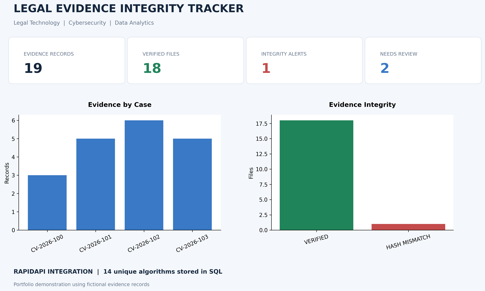

# Legal Evidence Integrity Tracker

**A Python and SQL portfolio project exploring digital evidence integrity in legal workflows.**

**Technologies:** Python · Pandas · SHA-256 (`hashlib`) · SQLite / SQL · RapidAPI · Matplotlib · Google Colab

## The Problem

In litigation support and electronic discovery, teams may need to check whether a digital file still matches a previously recorded version. A cryptographic hash provides a repeatable fingerprint of a file's bytes: when the file changes, its SHA-256 fingerprint will ordinarily change too.

This project demonstrates how Python, data cleaning, hashing, SQL, and reporting can work together to support that verification process. It uses **fictional evidence and simulated modifications**, not actual client records.

## Explore the Code

**[View the complete Google Colab notebook and its executed outputs](Legal_Evidence_Integrity_Tracker%20(2).ipynb)**

The notebook is the main technical demonstration: follow the Python code and saved results from dataset preparation through integrity checks, database operations, API exploration, and visualization.

## Results at a Glance

| Measure | Demonstration result |
|---|---:|
| Initial fictional evidence records | 20 |
| Unique records retained after cleaning | 19 |
| Sample files successfully verified | 18 |
| Deliberately detected SHA-256 mismatch | 1 |
| Records flagged for missing metadata | 2 |
| Hashing algorithms discovered through RapidAPI | 14 |

**Why the mismatch matters:** When a newly calculated SHA-256 fingerprint differs from a previously recorded fingerprint, the file no longer matches that baseline byte-for-byte. The result flags a difference for investigation; **it does not establish who changed the file, when the change happened, or whether it was improper**.

## Project Dashboard

The dashboard summarizes the fictional evidence dataset and verification outcomes using SQL, Pandas, and Matplotlib.

## How the Workflow Works

1. **Prepare evidence metadata:** Create a fictional dataset and use Pandas to identify duplicates and missing fields.
2. **Generate sample files and fingerprints:** Use Python's `hashlib` to calculate SHA-256 hashes locally.
3. **Verify integrity:** Compare calculated fingerprints against recorded values and flag a deliberately modified sample.
4. **Record the results:** Store evidence metadata and verification history in SQLite; query the tables using SQL.
5. **Explore an external API:** Use the Encryptly Hashing API through RapidAPI to retrieve a list of supported algorithms, clean the response, and save it to SQL.
6. **Analyze and visualize:** Use Pandas and Matplotlib to present the verification results.

**API distinction:** RapidAPI is used for **algorithm discovery** in this project. The evidence-file SHA-256 fingerprints are calculated **locally in Python**, not by the external API.

## Skills Demonstrated

| Skill | Evidence in the project |
|---|---|
| Python programming | File handling, repeatable verification logic, and workflow automation |
| Data cleaning and analysis | Pandas transformations, duplicate handling, and metadata checks |
| Cryptographic hashing | SHA-256 fingerprint generation and comparison with `hashlib` |
| Relational databases | SQLite tables, stored verification logs, and SQL queries |
| API integration | Authenticated RapidAPI request, JSON processing, and SQL storage |
| Data visualization | Matplotlib dashboard and summarized verification metrics |
| Technical documentation | Executable Google Colab notebook with saved outputs |

## Repository Files

- **[Google Colab notebook](Legal_Evidence_Integrity_Tracker%20(2).ipynb)** — complete source code and executed results.
- **[Clean evidence dataset](clean_legal_evidence.csv)** — fictional evidence metadata after cleaning.
- **[Evidence fingerprints](evidence_with_hashes.csv)** — sample evidence records with SHA-256 hashes.
- **[Verification log](evidence_verification_log.csv)** — recorded integrity-check outcomes.
- **[SQLite database](legal_evidence.db)** — sample database produced by the notebook.
- **[Dashboard image](legal_evidence_dashboard_final.png)** — exported project visualization.

## Reproducing the Demonstration

Open the notebook in Google Colab and run the cells in order. The workflow uses Python libraries including Pandas, Matplotlib, SQLite, and `hashlib`. The **RapidAPI portion requires your own API access and a Colab secret**; never paste an API key into the notebook or commit it to GitHub. Existing saved notebook outputs and the exported project files can be reviewed without making a new API request.

## Scope and Limitations

This is an **educational technical portfolio project**, not a deployed legal evidence-management system. All records and case identifiers are fictional. A matching fingerprint can support a byte-for-byte comparison with a trusted baseline, but a hash alone does not authenticate a source, establish a chain of custody, or prove when or why a modification occurred. The project does not provide legal or forensic conclusions.
